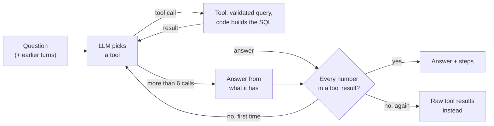
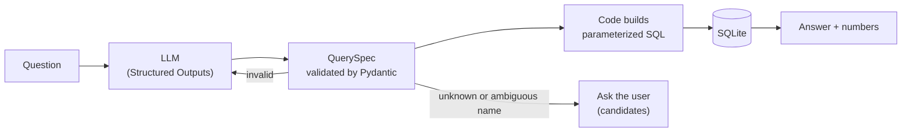

# European basketball stats Q&A

Ask a question about Euroleague, EuroCup or Greek league basketball in plain English, and get the
answer with the numbers behind it. An LLM turns the question into a validated query; code, not
the LLM, builds the SQL.

**Status:**
- **Data:** three seasons of Euroleague (862 games), two of EuroCup (323) and the Greek league
  (381), about 890,000 stat rows, kept current by a daily update job.
- **Quality:** 98-99 of 99 eval questions right, plus a 12-question held-out set; 15/15 on the
  agent's own eval; 263 tests.
- **Two ways to ask:** `POST /ask` for one lookup, and `POST /agent`, a LangGraph agent that
  plans several lookups and remembers the conversation for follow-ups.
- **Runs** in Docker. Next: Azure.

## Demo

Real questions sent to `POST /ask` on 2026-11-24 (2026-27 Euroleague and EuroCup, regenerate with
`python -m scripts.demo`). Each shows what the LLM produced and what the code answered:

<!-- Generated by scripts/demo.py on 2026-11-24 -->

**"Compare Panathinaikos and Zalgiris forced turnovers and steals this season"**

The LLM's output (validated, then turned into SQL by code):

```json
{"ranking": "matchup", "stats": ["forced_turnovers", "steals"], "competition": "euroleague", "season": "2026-27", "per": "game", "order": "highest", "side": "team", "team_a": "Panathinaikos", "team_b": "Zalgiris"}
```

Answer:

```text
Panathinaikos AKTOR Athens (13 games) vs Zalgiris Kaunas (13 games), ranks out of 20 teams:
  forced_turnovers      13.8 (#6/20)     11.5 (#17/20)
  steals                 6.7 (#9/20)      5.7 (#18/20)
```

**"Kendrick Nunn's 3-point percentage in his last 5 games"**

The LLM's output (validated, then turned into SQL by code):

```json
{"last_n": 5, "competition": "euroleague", "stats": ["fg3_pct"], "player": "Kendrick Nunn"}
```

Answer:

```text
Kendrick Nunn (last_n=5), 5 games:
  fg3_pct: 13/32 = 40.6%
```

**"Olympiacos points per game with and without Fournier this season"**

The LLM's output (validated, then turned into SQL by code):

```json
{"competition": "euroleague", "season": "2026-27", "stats": ["points"], "team": "Olympiacos", "compare": [{"with_player": "Fournier", "competition": "euroleague", "label": "with Fournier"}, {"without_player": "Fournier", "competition": "euroleague", "label": "without Fournier"}]}
```

Answer:

```text
Olympiacos Piraeus (season=2026-27), compared:
  with Fournier: 10 games
  without Fournier: 3 games
  points: with Fournier 93.6 per game | without Fournier 75.3 per game
```

**"Top 5 scorers in the EuroCup this season"**

The LLM's output (validated, then turned into SQL by code):

```json
{"ranking": "player_rankings", "stats": ["points"], "competition": "eurocup", "season": "2026-27", "per": "game", "limit": 5, "order": "highest"}
```

Answer:

```text
Player rankings by points (competition=eurocup, season=2026-27; per game; 4+ games, out of 366 players):
    1. Timmy Allen (Kids&Us Manresa)  22.5  [4 games]
    2. Cedi Osman (PAOK Thessaloniki)  22.2  [6 games]
    3. Kenny Lofton Jr. (Hapoel Midtown Jerusalem)  20.2  [8 games]
    4. Javante Mccoy (Balkan Botevgrad)  20.0  [6 games]
    5. Breein Tyree (PAOK Thessaloniki)  19.4  [8 games]
```

**"Which team allows the fewest points per game this season?"**

The LLM's output (validated, then turned into SQL by code):

```json
{"ranking": "team_rankings", "stats": ["points"], "competition": "euroleague", "season": "2026-27", "per": "game", "order": "lowest", "side": "opponent"}
```

Answer:

```text
Team rankings (season=2026-27, order=lowest; per game, what teams allowed), by points:
   1. Partizan Mozzart Bet Belgrade  78.3
   2. Panathinaikos AKTOR Athens  78.4
   3. Fenerbahce Tarfin Istanbul  78.8
   4. Crvena Zvezda Meridianbet Belgrade  80.5
   5. Olympiacos Piraeus  81.5
   6. Dubai Basketball  83.9
   7. Zalgiris Kaunas  85.2
  ...
```

**"Who will win the Euroleague this season?"**

Answer (unanswerable):

```text
A query can't predict who will win the Euroleague.
```

The last one is a refusal on purpose: when the data can't answer a question, the app says so
instead of guessing.

## Multi-step questions and follow-ups (`POST /agent`)

Some questions need more than one lookup, or build on the previous one. `POST /agent` runs a
LangGraph agent: the LLM picks a tool, reads the result, and calls more until it can answer.
A real conversation from 2026-11-25 (fields left at their defaults are not shown):

**"Is Panathinaikos rebounding better in its last 6 games than over the whole season?"**

```json
{"tool": "query_stats", "args": {"team": "Panathinaikos", "season": "2026-27", "stats": ["total_rebounds"],
  "compare": [{"label": "Last 6", "season": "2026-27", "last_n": 6}, {"label": "Season", "season": "2026-27"}]}}
```

> Yes. Panathinaikos is averaging **37.7 rebounds per game** over its last **6** games, compared
> with **36.9** across **14** games this season. *(number check: passed)*

**"And Zalgiris?"** (same `conversation_id`)

```json
{"tool": "query_stats", "args": {"team": "Zalgiris", "season": "2026-27", "stats": ["total_rebounds"],
  "compare": [{"label": "Last 6", "season": "2026-27", "last_n": 6}, {"label": "Season", "season": "2026-27"}]}}
```

> Yes. Zalgiris is averaging **42.5 rebounds per game** in its last **6** games, up from **40.4**
> across **13** games this season. *(number check: passed)*



**The same guarantees as `/ask`, plus a few more:**
- **The tools are the existing queries:** stats with filters, team and player rankings, matchup,
  profile, name lookup, roster. The LLM fills in their validated arguments, never SQL, and every
  tool only reads.
- **At most 6 tool calls per question,** so it can't loop or run up a bill.
- **Every number in the answer is checked** against the tool results. An unbacked number is
  sent back to the LLM once; if it is still there, you get the raw tool results instead.
- **Every step is in the response:** each tool, its arguments and its result, so any answer can
  be traced.
- **Follow-ups:** send back the `conversation_id`, and "And Zalgiris?" keeps the earlier stats
  and filters. Conversations are kept in memory (lost on restart).

It is slower than `/ask` (several LLM calls, usually 5-15 s), so `/ask` stays the fast path for
one-lookup questions.

## How it works



**Why the LLM never writes SQL:**
- **Its only job is to fill in a form.** The LLM chooses from a fixed list of fields: which
  player or team, which stats, which filters (opponent, home/away, last N games, with or without
  a player, a season, and so on).
- **The form is checked before anything runs.** Pydantic validates it, and an invalid one goes
  back to the model once with the errors.
- **Code turns the checked form into SQL,** always with parameters, never by pasting text in.
- **What that buys:**
  - No SQL injection.
  - No query that silently computes the wrong thing. For example, shooting percentages are always
    total makes divided by total attempts, never an average of each game's percentage.
  - Every answer can be traced back to the form that produced it.
- **Names are matched separately,** against alias tables: "Vezenkov", "Sasha Vezenkov" and
  "VEZENKOV, SASHA" are the same player. An ambiguous name returns candidates instead of a
  guess.

## Evaluation

`eval/questions.jsonl` has 99 questions with hand-written gold answers, covering 19 kinds of
question:
- basic stats
- opponent, venue, last N, over .500, rest days
- with/without a player
- comparisons and rankings
- shot-list stats
- Greek league and EuroCup
- questions that should be refused

A question counts as correct when its answer matches the gold answer's, so two different but
equivalent queries both pass.

`eval/heldout_questions.jsonl` has 12 questions written separately, in everyday wording with typos
("his season", "juancho plays"). None of them, and none of their names, appear in the prompt, so
they test whether the parser generalizes rather than recognizes its own examples.

| Set | Score (gpt-6-luna) |
| --- | --- |
| Main (99 questions) | 98-99/99, depending on the run |
| Held-out (12) | 12/12 |
| Agent (15 conversations, 32 facts) | 15/15 and 32/32 in two runs, no fallback answers |

`eval/agent_questions.jsonl` tests the agent:
- **15 conversations (18 turns):** compares, two teams or players, find-then-look-up,
  with/without, follow-ups, and questions it must decline.
- **Each expected fact is a reference query the eval runs itself,** so newly loaded games never
  make the set stale.
- **A turn passes when its answer states every fact.**

```powershell
python -m eval.run_eval --check-gold                          # no LLM: every gold answer runs
python -m eval.run_eval                                       # accuracy per category + failures
python -m eval.run_eval --file eval/heldout_questions.jsonl
python -m eval.run_agent_eval --check-gold                    # no LLM: every reference query runs
python -m eval.run_agent_eval                                 # the agent, with the real model
```

## Quick start

The database isn't in the repository. Build it with the loaders (see
[docs/REFERENCE.md](docs/REFERENCE.md)), then run the app in Docker or locally.

**Docker** (needs Docker Desktop and a `.env` with `OPENAI_API_KEY`):

```powershell
docker compose up --build -d     # then open http://localhost:8000/docs
docker compose down
```

The image holds only the code and its pinned packages. `data/` is mounted read-only, and `.env`
is passed in at start, so neither the database nor the key is ever inside the image.

**Locally** (Windows, PowerShell, Python 3.13):

```powershell
python -m venv .venv
.\.venv\Scripts\Activate.ps1
pip install -r requirements.txt
python init_db.py                 # creates any missing tables; never deletes data
copy .env.example .env            # then add your OpenAI key (needed for /ask, /agent and the evals)
python -m ingestion.euroleague --season 2026    # load a season (cached in data/raw/)
uvicorn api.main:app --reload     # then open http://127.0.0.1:8000/docs
python -m pytest
```

## What you can ask

- **Filters:**
  - opponent; home, away or neutral; last N games
  - opponents over .500 *as of that game's date*
  - with, without or against a player (whole games)
  - teammates on the floor or on the bench at the same time ("Campazzo's +/- on the court with
    Tavares"): minutes, plus-minus, the team's points and the player's own stats in that time
  - clutch time: the last 5 minutes of the 4th quarter or overtime, within 5 points
  - a player's own minutes or points in that game ("when Lessort plays 30+ minutes")
  - days of rest
  - the team's coach ("Fenerbahce under Jasikevicius") or the game's referee
  - season, several seasons, regular season or playoffs
- **Season:** a question that names no season or time span means this season, rankings too.
  "Last 10 games", "career", "all-time" or "last 3 seasons" go wider. If this season has no
  matching games yet, the answer uses last season and says so; with 1-4 games it is flagged as a
  small sample and last season is shown next to it (unless the question named the season). (`POST /query` and
  `POST /rankings` take the spec as given: no `season` there means every loaded season.)
- **Comparisons:** 2-4 sides in one question ("with X vs without X", "this season vs last").
- **Rankings:** every team or player ranked on a stat; where one team or player ranks; two teams
  side by side; a player's rank in all 47 player stats.
- **Lineups:** a team's best duos, trios or 5-man lineups by plus-minus per 40 minutes together
  ("Panathinaikos' best duo", "most used lineup", "best trio with Campazzo"). No minutes cutoff:
  groups under 40 minutes together are listed and flagged as small samples.
- **Advanced stats:**
  - team: pace, offensive, defensive and net rating, eFG%, TS%, turnover %, rebound %, forced
    turnovers
  - player: usage % and more
- **Shot-list stats:** paint points (worked out from shot coordinates), fast-break,
  second-chance and points off turnovers.
- **Quarter and half points** for teams, scored or allowed ("4th quarter points",
  "fewest first-half points allowed"), and for players.

Every endpoint, filter and stat is in [docs/REFERENCE.md](docs/REFERENCE.md).

## Tech stack

- **Language:** Python 3.13.
- **Database:** SQLite, with no ORM. Queries are hand-written and parameterized.
- **API:** FastAPI, with Pydantic for every request and the LLM's output.
- **LLM:** OpenAI Structured Outputs (`/ask`); LangGraph with `langchain-openai` tool calling
  (`/agent`).
- **Data:** pandas, from the `euroleague-api` package.
- **Tests and running:** pytest, Docker.

## Data sources

- **Euroleague and EuroCup:** Euroleague Basketball's public stats API, through the
  [`euroleague-api`](https://github.com/giasemidis/euroleague_api) package.
  - This project is unofficial and not affiliated with Euroleague Basketball.
  - As of 2026-11-24, neither the website nor the API has a robots.txt, and the site footer
    links no terms of use (only cookie and privacy policies).
  - The data itself isn't redistributed: only the few example answers above.
- **Greek league (Stoiximan GBL):** esake.gr game pages. Their terms allow personal use only, so
  the Greek data stays local and isn't shown in this README.
- **Being polite to both sources:** every page is fetched once and saved under `data/raw/`
  (git-ignored), with at least one second between requests.

## Roadmap

0. Housekeeping ✅
1. Euroleague ingestion ✅
2. Name resolution (team and player aliases) ✅
3. Query layer ✅
4. FastAPI + Pydantic API ✅
5. LLM question → validated `QuerySpec`, with an eval set ✅
6. Greek league and EuroCup ✅
7. Docker ✅ · README demo ✅ · LangGraph agent for multi-step questions ✅ · Azure deployment
